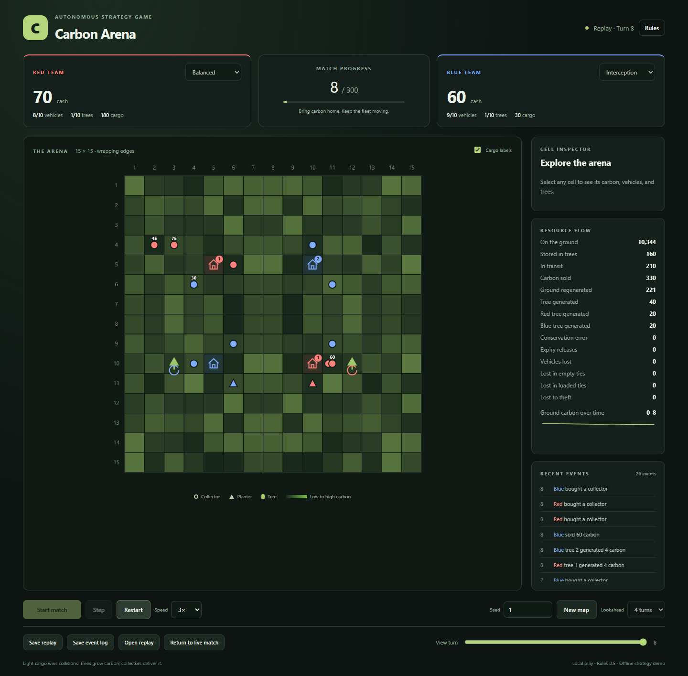

# Carbon Arena

A local strategy-game experiment: two teams collect carbon, grow trees, buy vehicles, and compete on a shared grid. Strategies are written ahead of time, then run automatically in an isolated JavaScript sandbox. Matches do not call an AI service.

This is a personal, AI-assisted project developed through iterative collaboration with AI tools. It explores game rules, strategy interfaces, reproducible play, and transparent verification. It is an experimental local application, not an independently controlled benchmark of AI model quality. Entrant model labels are supplied by the organizer.



## Try the offline demo

Open **[playable-v0.5/index.html](playable-v0.5/index.html)** in a desktop browser. No installation or internet connection is needed. Choose the built-in strategies, play a match, inspect the board, and export or import a replay. These bundled planners are examples, not private tournament submissions.

## Run the complete arena

Install Node.js **22 or newer**. In this project folder, run:

```sh
npm ci
npm start
```

Open **http://127.0.0.1:4327**. On Windows, after the one-time installation, you can also double-click **Start-Carbon-Arena.cmd**. Keep its window open while the arena runs. Stop it with Ctrl+C while idle.

Installation downloads the pinned QuickJS dependency and development test tools, and builds the public entry-kit download. Match execution and the interface work locally afterward. No AI account, API key, Python installation, or live model connection is required.

This publication uses port **4327** so it can run alongside an earlier local installation. It creates a new, empty archive in `competition/data/`; original event records are not part of this repository. Do not point it at an older installation's archive. Each running process needs its own archive.

## What you can do

| Page | Purpose |
| --- | --- |
| Home | Register JavaScript strategies, try the six-game demonstration, run practice or rated challenges, and inspect Elo standings and replays |
| Practice | Compare two strategies on one map in both colors, without rating changes |
| Season Two | Freeze three strategies and run a 36-game round robin on six shared maps |
| Curtain Call | Run a separate 60-game event on ten shared maps and download its completed results |

Start with **Try a six-match demonstration** on the home page. It uses only the two included public examples and awards no rating or title. To try quick Practice instead, register `competition/examples/harvester.js` and `competition/examples/wait.js` using **Upload a strategy**, then choose them as the pair.

Every game uses rules 0.5: a 15 x 15 toroidal grid, four starting vehicles and 100 cash per team, and 300 turns. Each map is played with colors swapped. Trees generate carbon for exactly 50 working turns. See the [rulebook](Carbon-Arena-Rules-v0.5.md) for mechanics and [strategy entry guide](competition/ENTRY-KIT.md) for `decide(snapshot, team, memory)`.

Formal challenges check carbon conservation, reconstruct saved decisions, repeat the complete strategy execution, and compare physical results with an independently authored resolver. Quick Practice checks conservation, replay reconstruction and the independent resolver, but omits the full strategy rerun and records that distinction.

## Development checks

```sh
npm test
npx playwright install chromium
npm run test:demo
npm run test:practice
npm run test:championship
```

The browser rehearsals create disposable public-fixture records under `competition/verification/` on an automatically assigned local port. They do not use the default archive. You can set `PLAYWRIGHT_EXECUTABLE_PATH` to use an existing compatible Chromium installation. Read [validation coverage](docs/VALIDATION.md) for what was actually checked for this release.

## Project layout

| Directory | Contents |
| --- | --- |
| `playable-v0.5/` | Self-contained browser demo and replay viewer |
| `competition/` | Local server, tournament policies, Practice, English interface and public examples |
| `duel/` | Reused QuickJS sandbox and pinned runtime dependency |
| `tools/verification/` | Independently authored resolver and comparator, with original attribution retained |
| `tests/fixtures/` | Legacy engine used only for compatibility tests |
| `docs/` | Setup, publication scope and validation notes |

## Local records and scope

This repository contains code, rules, tests and public examples. It excludes the original competition archive, private contestant strategies, sealed evidence, owner keys, sessions, organizer receipts, backups, historical delivery archives and installed dependencies. New local records and generated downloads are ignored by Git. Back up your own `competition/data/` while idle if you run an event.

The server binds only to `127.0.0.1`. It is intended for a trusted local computer; it has no public accounts or hosted multiplayer service. The local owner-access mechanism remains in the code and generates a new key for each fresh archive. Original owner launch capabilities are not distributed.

The game mechanics and QuickJS execution limits are preserved. Publication changes cover English text, portable setup and tests, a fresh archive, public source-kit generation, and removal of workstation-specific packaging behavior. Original local work and its real match history are retained separately.
